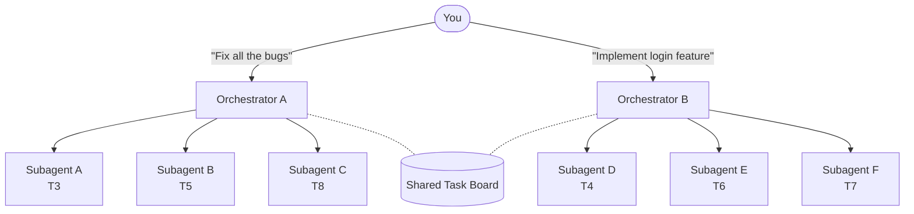

# APE: Agentic Plaintext Engineering

**Run swarms of coding agents without becoming the bottleneck.**

APE gives your agents a local-only plaintext task board and memory system to track tasks, distribute work, and keep things moving without checking with you at every step.



## How it works

After [installing](#installing), your agents organise work into *tasks* (T1, T2, …). When they need a decision from you, the human *owner*, they decide for themselves whether work can continue without your answer. If it can't, they mark the task *blocked*. Otherwise, they follow their recommendation as a *provisional* decision until you answer.

A basic loop can look like this:

1. Prompt your main agent: `Plan the tasks ahead`
2. Approve the plan, pick specific tasks to skip/do, and answer any pending questions
3. Your main agent starts spawning subagent(s) to work

Or, use this even simpler prompt: `I'm going to sleep, do everything that doesn't require me`.

You never need to look at the board yourself. The workflow is really just to talk to your main agent:

- `What pending tasks are there?`
- `What needs my decision?`
- `Do T12 and T15`
- `File a bug: login fails on Safari`
- `Audit the docs`

## Installing

> [!NOTE]
> Linux and macOS only (sorry Windows users).

Prompt your agent:

```md
Look at https://github.com/AaronCQL/ape, set it up in this repo, then plan T1.
```

The first task (T1) moves what's only yours (plans, notes, status, private names) into APE's private store and removes it from your repo. Rules shared with everyone working on the code (build, test, style in `AGENTS.md`) stay where your teammates' agents read them; APE adds a short pointer at the top of `AGENTS.md`. Your agent should tell you the plan and ask for your approval first. If your repo is already using git, it should be easy to undo.

<details>
<summary>Manual install, like an animal</summary>

Install the `ape` CLI first:

```sh
curl -fsSL https://raw.githubusercontent.com/AaronCQL/ape/main/install.sh | sh
```

Or, from source:

```sh
go install github.com/AaronCQL/ape@latest
```

Then, run `ape init` while in your target directory or repository, which creates the `ape/` dir and task T1. You may now prompt your agent to `Plan T1`.

</details>

## Who it's for

APE is for you if your workflow consists of running orchestrator(s) with multiple subagents at once, and keeping them coordinated is becoming harder:

- Agents wrongly doing the same task, or polluting each other's files and causing merge conflicts
- Losing track of what's in progress, what's done, and what's waiting on you
- Agents randomly littering context around different files

If you're still babysitting a single agent by itself, it's still a decent way to keep track of tasks.

## Features

APE is basically a kanban board for agents, kept locally in the language they understand best: *plaintext*.

- **Private and local-only**: plans and tasks live in their own git repo, ignored by your code repo, so your secret plans never get committed.
- **Focused on the now**: no changelogs, session logs, or "what was done" to bloat up context; the past lives in git, searched only when needed.
- **Built for parallel work**: works even if orchestrators and subagents cannot directly communicate; all actions done are atomic.
- **Works in a team**: each person's board is their own; shared rules stay in the repo and the shared backlog in your issue tracker, so teammates without APE lose nothing.
- **Just plain old plaintext**: no complex dashboards, APIs, MCPs, or databases to manage.

## License

MIT
